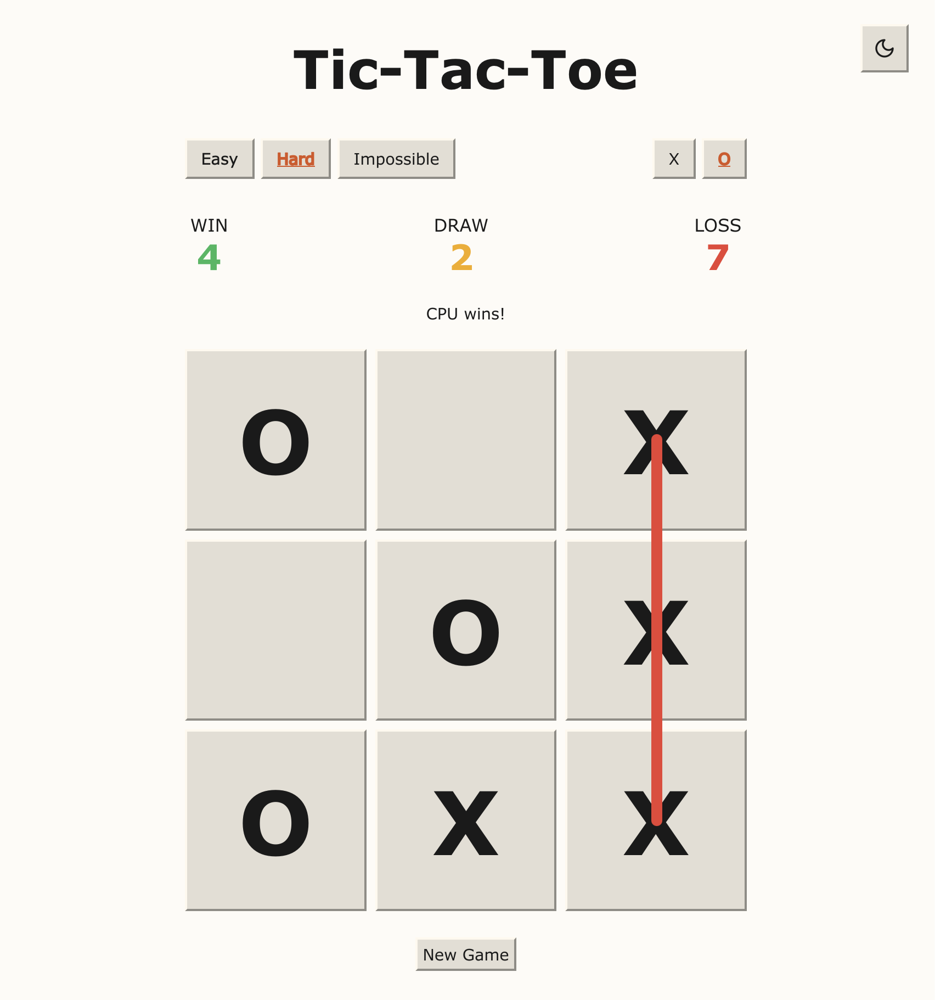
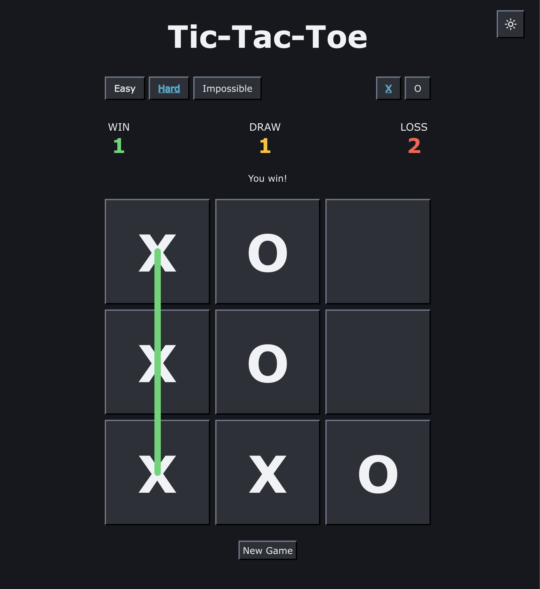

# simple-ttt

A very simple Tic-Tac-Toe web application for **single player**.

## Features: 
- Light and dark mode toggle!
- Play as 'x' (first) or 'o' (second)
- Three levels of difficulty for the CPU
  - Easy: CPU makes random moves
  - Hard: CPU will play/block a "win in 1"
  - Impossible: CPU will play optimally (please see callout below)
- Tracks session results

> [!IMPORTANT]
> There is currently an error in the logic for the 'impossible' difficulty, so it is currently **not** optimal and easily beatable.

## Screenshots:

  
  

